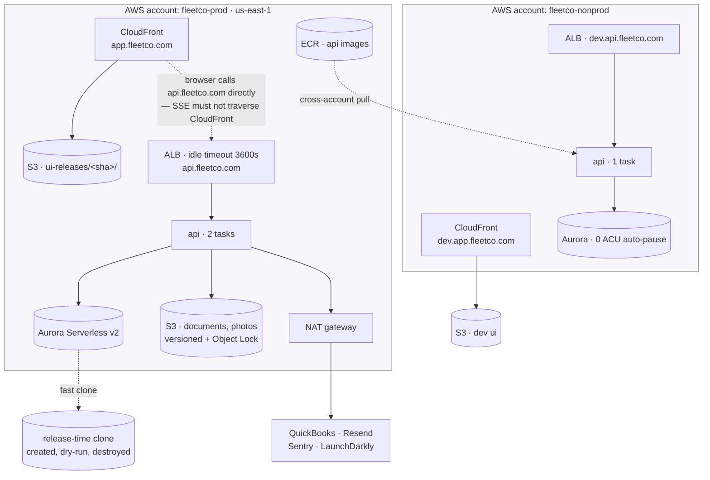

## Overview

What to build in AWS, in what order, what moves code through it, how much of it an agent can do, and
what only Dave can do.

**Two environments. No stage.** An earlier version of this document specified a third environment —
the next release running against production's own database — and an adversarial review found seven
serious problems with it, all stemming from one cause: two code versions sharing a live database
permanently. It was dropped on 2026-11-08. The option space and the reasoning are in
[[Environment Strategy Options]]; the decision log is at [[#Decisions]].

## The Strategy

| | What it is |
|---|---|
| **`prod`** | The real thing. OTC runs on it |
| **`dev`** | Separate AWS account, synthetic data, deployed from CI, reachable from a laptop. Where everything gets built |

Next-version work is exercised by **three mechanisms instead of a third environment:**

1. **Feature flags.** A new feature ships to production switched off, then on for Dave, then for
   Cameron, then for everyone. This is what `stage` was for, and it is per *feature* rather than per
   *release*, which suits small incremental changes better.
2. **A test business inside production.** OTC's tenant holds several lines of business — graphics,
   fleet, trailers — and Dave gets his own. Real system, real code, isolated data, deletable. Nothing
   done there touches OTC's books.
3. **Clone-and-dry-run on every release.** The pipeline clones production's database, runs the
   release's migrations against the copy, records the timing, and throws the clone away. Migration
   rehearsal on real data, automatically, with no environment to maintain.

**Why this beats a third environment.** The thing a staging environment uniquely provides is a
dress rehearsal on realistic data. Mechanism 3 provides exactly that, for the operation that
actually needs it, without a permanent second stack — and mechanisms 1 and 2 cover "let someone try
it before everyone gets it" without two code versions ever sharing a database for more than the
minutes of a rolling deploy.

**Deferred, not rejected: a stage environment on a *clone* of production — never on production
itself.** About a day of work to add, because everything it needs gets built anyway: environment-
parameterized Terraform modules, runtime UI config, build-once-promote-the-artifact, and the clone
automation from mechanism 3. **The trigger is the first change that cannot be put behind a flag and
that makes Dave nervous** — a framework major, a large refactor, a dependency bump with real
surface area.

## Target Topology

### Accounts

Three AWS accounts in one Organization (ADR-025):

| Account | Holds |
|---|---|
| `fleetco-management` | Organizations root, IAM Identity Center, consolidated billing, SCPs. **No workloads.** Owned by OTC (B2); Cameron holds root |
| `fleetco-prod` | VPC, Aurora, S3, ALB, CloudFront, ECR, the `api` service |
| `fleetco-nonprod` | Everything for `dev` — own VPC, own Aurora, own buckets, own ALB |

With `stage` gone, **ADR-025's account boundary is the whole guard again** rather than a partial
one. There is no deployed thing in the production account that is not production.

### The System



### Why The API Is Not Behind CloudFront

CloudFront in front of everything with `/api/*` routed to the ALB is the natural instinct — one
origin, no CORS, a WAF for free. **Don't, at least not for V1.** SSE holds a connection open for an
hour and CloudFront applies its own origin read timeout to that path. Whether a frequent enough
heartbeat survives is something we would have to prove, and SSE breaking invisibly is already the
most likely configuration bug in this stack ([[Hosting and Deployment]] says so about the ALB idle
timeout; this would be a second copy of the same bug).

So: **static files from CloudFront, API straight to the ALB, CORS configured.** Four hostnames:

| | UI | API |
|---|---|---|
| `prod` | `app.fleetco.com` | `api.fleetco.com` |
| `dev` | `dev.app.fleetco.com` | `dev.api.fleetco.com` |

**`dev` sits on a different registrable domain in practice** — see B18. A session cookie must never
be transmittable to the non-production account.

### The Worker: Resolve The Docs Against The Code

**Two existing documents disagree, and the code settles it.** [[Realtime and Events]] says events
are "dispatched in-process." [[Hosting and Deployment]] draws a separate `worker` service. The code
starts the dispatcher inside the API process (`fleetco-nestjs-vehicles/src/main.ts:49`), there is no
worker entrypoint, and `platform/outbox/dispatcher.ts:22` records that there is no handler registry
yet.

**For V1: in-process, matching the code.** Two API tasks means two dispatchers, which is safe —
`FOR UPDATE SKIP LOCKED` guarantees each row is claimed once — and it removes a deployable.

**Split the worker out when a handler does real outbound work** (QuickBooks sync, bulk email), so a
slow vendor call cannot inflate request latency. That was [[Hosting and Deployment]]'s original
argument and it is still right; it just is not true yet. **[[Hosting and Deployment]] must be
corrected** so the diagram stops describing a service that does not exist — INFRA-050.

### Getting At The Data

| Need | How | Cost |
|---|---|---|
| **Local UI against the deployed `dev` API** — the daily case | CORS plus a hostname; the UI's `config.json` points at `dev.api` | **$0** |
| Ad-hoc SQL | **RDS Data API + the console Query Editor.** Browser, no tunnel, IAM-gated | **$0** |
| A shell in a running task | `aws ecs execute-command` | $0 |
| A local GUI or local API against a deployed database — rare | `modules/tunnel`, applied when needed, destroyed after | pennies |

**No standing bastion in either account.** Two corrections to an earlier draft of this document,
both verified:

- **The Data API requires a Secrets Manager secret**, which conflicts with
  [[Hosting and Deployment]]'s choice of Parameter Store. One secret at $0.40/month; the exception
  is worth recording rather than leaving as a silent contradiction.
- **CloudTrail records that a statement ran and by whom, but redacts the SQL text.** The earlier
  claim of "every query in CloudTrail" was wrong. It is an access trail, not a query log.

**Decision (B17, revised): the production Data API secret is bound to a read-only database role.**
That keeps the diagnostic value and removes the destructive surface. Writes go through admin tooling
in the application ([[Infrastructure Checklist]] P1) or a reviewed script via `execute-command`.

## Infrastructure as Code

**Terraform** (B3, resolving ADR-026's open choice). The deciding criterion: `terraform plan` is a
legible diff of real resources, so **the plan is the artifact Dave reviews instead of reviewing the
agent's reasoning.** CDK's TypeScript advantage is real and loses to that.

```
infra/
  modules/
    network/        VPC, subnets, security groups, NAT (prod only)
    data/           Aurora, parameter groups, S3, KMS
    service/        ECS service + task def + target group + listener rule + log group
    frontend/       S3 origin + CloudFront + OAC + SPA routing + cert
    scheduled/      EventBridge Scheduler → ECS RunTask
    observability/  dashboard, alarms, metric filters, SNS
    tunnel/         on-demand bastion, applied and destroyed
    clone/          fast clone for the release dry-run
  envs/
    prod/
    dev/
  bootstrap/        state bucket, OIDC provider, deploy roles
```

Separate root modules per environment, not workspaces. State in S3 per account with native S3
locking — `prod` state in the prod account, `dev` state in nonprod, so blast radius matches the
account split.

## CI/CD

GitHub Actions, GitHub OIDC for AWS auth, **no long-lived AWS keys anywhere.** One private monorepo
in a new OTC GitHub org: `apps/api`, `apps/web`, `packages/contracts`, `packages/api-client`,
`infra/`. **Shape set by ADR-036, which supersedes B4** — B4 said "one monorepo" and stopped there;
ADR-036 adds the part it missed, that **the product repository and the planning repository are
separate.** Engagement terms, pricing and meeting transcripts stay in the planning repository, for
access reasons rather than tidiness: the product repository will be shared with contractors,
possibly Charlie, possibly owned by OTC, and scrubbing commercial material out of git history later
is far harder than never committing it.

**One consequence for this document:** it belongs in the planning repository and stays here, but the
ADR log, [[Tenancy Model]], [[Code Standards and Guardrails]], [[Testing Strategy]],
[[Agent Playbooks]], [[Domain Model]] and [[Rules Catalog]] move to the product repository the day
it is created. M6 work, not now.

### Build Once, Promote The Artifact

What reaches production is byte-identical to what passed CI and ran in `dev`. Never rebuilt, never
re-tagged from source. Two artifacts:

- **API — the image digest.** `sha256:...`, pulled from ECR.
- **UI — a versioned S3 prefix.** `s3://.../ui-releases/<sha>/`, promoted by pointing a CloudFront
  origin path at it. Rollback is a config change with no rebuild.

Which is why **the frontend reads its API base URL at runtime, not at build time** — one UI artifact
has to serve both environments, and a baked-in URL forces a rebuild per environment and destroys the
identical-artifact property.

### Pipelines

| Workflow | Trigger | Does |
|---|---|---|
| `ci.yml` | every PR | typecheck · lint · unit · integration on ephemeral Postgres · **cross-tenant and cross-business leak suite (no override)** · migrate-from-scratch · rule-coverage gate · **flag gates** (below) · `gitleaks` · `docker build` (no push) · `terraform plan` for both environments as a PR comment |
| `deploy-dev.yml` | push to `main` | build + push, capture digest · `terraform apply` nonprod · migration task · update the service · smoke |
| `release-prod.yml` | manual, takes a digest + UI sha, `v*` tag only | **clone-and-dry-run** · additive-only check · snapshot · migrate · roll the API · smoke · tag |
| `contract.yml` | manual, one release later | drop what the previous release stopped using |
| `drift.yml` | nightly | `terraform plan -detailed-exitcode` in both accounts; issue on non-zero |

### The Clone-And-Dry-Run Gate

**The piece that replaces a staging environment**, and the reason the strategy holds.

Before a production release touches anything: fast-clone the production database, run the release's
migrations against the clone, record how long each took, destroy the clone. Aurora cloning is
copy-on-write so it is near-instant and near-free, and a Serverless v2 clone at a 0 ACU floor costs
nothing once idle.

**Why it is in the normal path and not an on-demand tool.** On-demand rehearsal rots. The realistic
failure is a frightening migration arriving, the rehearsal script being broken from disuse, and the
release shipping unrehearsed because it is already late. Running it on every release means it cannot
rot, and the cost is a few minutes of pipeline time.

It also exercises the clone-and-restore path continuously, which is what makes [[Operations]]'
restore drill a verification rather than a first attempt.

### The Additive-Only Migration Gate

Every migration in a release must be safe against the *currently deployed* code, because a rolling
deploy runs both versions for a few minutes. Checked mechanically (INFRA-032), and as an
**allowlist, not a denylist** — a correction from the review, which found that a denylist misses
`ADD CONSTRAINT ... NOT VALID`, a new unique index, `DROP INDEX`, `ALTER COLUMN SET DEFAULT`, DML in
a migration file, `TRUNCATE`, `ALTER SEQUENCE RESTART`, `CREATE TRIGGER`, and type widening.

**Allowed without annotation:** create table · add a nullable or defaulted column · non-unique
`CREATE INDEX CONCURRENTLY` · add an enum value. **Everything else fails CI** unless annotated and
reviewed.

**One rule that reverses the usual order:** a *new constraint* ships in the release **after** the
code that satisfies it. Adding a constraint the deployed code does not know about turns its writes
into errors — which is why the review flagged this document's own earlier `NOT VALID` advice as
violating [[Operations]]' backward-compatibility rule.

**Migration safety settings**, because this is what actually causes an outage:

| Operation | The trap | Do this |
|---|---|---|
| Add a column with a default | Fine in modern Postgres | Nothing |
| Add an index | Locks out writes | `CREATE INDEX CONCURRENTLY`, own file |
| Add `NOT NULL` or a foreign key | Full scan under lock | `NOT VALID`, then `VALIDATE` — **and only after the code satisfies it** |
| Rename anything | Breaks running code instantly | Add new, migrate, drop later |

**`lock_timeout` and `statement_timeout` on the migration connection.** The single most valuable and
most skipped setting: without it, a migration that cannot get its lock holds the queue and every
write in the application piles up behind it.

### Data Backfills Are Not Migrations

"Set this column on 400,000 existing rows" is a worker command, not a migration file. Idempotent,
resumable, batched by id, observable, with an alarm if it stalls. It runs **between** expand and
contract, never inside either, and a deploy never waits on one.

**Changing one column, end to end:** add nullable → deploy code that writes both and reads old →
backfill → deploy code that reads new and stops writing old → drop the old column one release later.
Five steps. **With `stage` gone this is correct as written** — the review found a lost-update hole in
it that only existed because `stage` could sit on step 4 for days while production sat on step 2.
The window is now the minutes of a rolling deploy.

### The Approve Button We Cannot Have

GitHub has a feature where a production deploy stops and waits for a named person to click
**Approve**. **We cannot use it.** It requires GitHub Enterprise ($21/person/month) on a private
repository; on Free, Pro and Team a private repo gets environments but not the human gate.

**What we keep, which is the part that matters.** The production AWS credentials are not a password
in the repo. GitHub vouches for the running job, and AWS hands over production access **only** to a
job that declares it is deploying to production. Every other job — every test run, every pull
request, every dev deploy — is refused.

**This is the line most likely to be written wrong.** Scoped to the repo instead of the repo *and*
environment, every test run in the repository can reach production and nothing else here matters.

**What replaces the button:** production deploys only run when a human starts them by hand and names
the artifact; only a `v*` tag may deploy to production; and **only Dave can create a `v*` tag**
(a tag ruleset) — plus **CODEOWNERS requiring his review on `.github/workflows/**` and
`infra/envs/prod/**`**, which the review correctly identified as the realistic path to production
credentials otherwise. INFRA-047.

And the honest part: **the approve button would have been Dave approving Dave.** With one person
shipping it was never a second pair of eyes. A production deploy needs to be deliberate, tagged and
logged, and all three survive.

### Rollback — Five Scenarios

| # | What went wrong | How you undo it | How long |
|---|---|---|---|
| 1 | **Bad code, no schema change** | Re-run the workflow naming the previous artifact | **~5 min** |
| 2 | **Bad code, and the release added to the schema** | Same. The new column sits unused — **the whole reason for additive-only** | **~5 min** |
| 3 | **Bad migration** | Usually nothing to undo — below | 0–30 min |
| 4 | **Bad data written by the new code** | **No deploy fixes this.** A repair script, informed by the audit log | Hours |
| 5 | **Bad infrastructure change** | `git revert` the Terraform change and apply | ~15 min |

**Case 3 is milder than it sounds.** Migrations run as their own job before any code deploys, so a
failed migration means nothing was deployed and production is untouched. Postgres also wraps schema
changes in a transaction, so a migration that dies partway rolls itself back — except
`CREATE INDEX CONCURRENTLY`, which needs its own file and its own cleanup. And the clone dry-run has
already run the same migrations against a copy of the same data, so case 3 should be rare by
construction.

**Case 4 is the one to respect.** Wrong values in real rows cannot be redeployed away, and
point-in-time recovery would take back every legitimate thing the shop did in that window. The
answer is a repair script, and what makes one possible is knowing exactly what changed — the audit
log that falls out of the outbox (ADR-009). **A compliance artifact on paper, an operational one in
practice.**

**Two ordering rules the review surfaced, both now explicit:**

- **Deploy API first, UI last. Roll back UI first, API last.** A new UI against an old API 404s on
  endpoints that do not exist yet; the reverse is harmless.
- **`index.html` is served no-cache**, or invalidated on every origin-path flip. Otherwise
  "promotion is a config change" serves the previous app for the length of the TTL.

### What Cannot Be Rolled Back

Anything that already left the building — an invoice email that was sent, a QuickBooks entry that was
pushed. The guard is **feature flags**, and the reason flags matter more here than in most projects:
with no staging environment, a flag is the only thing between a half-finished feature and a real
customer.

## Feature Flags, And The Two Gates That Make Them Safe

**LaunchDarkly, free Developer tier, behind a `FeatureFlags` port** (B9). Unlimited flags and seats,
1,000 client-side monthly users, 5 service connections. Billing is **per running process**, not per
environment, and fractional by connection time — production's 2 tasks plus `dev` scaled to zero
lands around 2.7, inside the free tier. Worst realistic case $10–20.

**Two conditions, non-negotiable, both consistent with ADR-023's rule about vendors in the request
path:**

- **Every flag has a default compiled into the application**, and the SDK runs in streaming mode with
  local evaluation. A LaunchDarkly outage must not change whether Fleetco can invoice. This gets a
  test.
- **Flags sit behind a port**, like `Telemetry` in ADR-028. One adapter, swappable.

**Two CI gates, because flags are now load-bearing and vigilance is the wrong mechanism:**

1. **Every flag referenced in code has a test exercising both branches.** Build fails otherwise.
   Three live flags is eight combinations; the suite has to cover both sides or an enabled path ships
   untested.
2. **Every flag records an expiry date at creation, and CI fails once it passes.** "Delete this flag"
   becomes a failing check with an obvious fix — work agents do well. The real mitigation for the
   permutation problem is **few flags alive at once, killed quickly**, and this enforces it.

**Flags are promoted from P2 to P0** on [[Infrastructure Checklist]]. Without a staging environment
they are part of the release mechanism, not a convenience.

## The Test Business

OTC is one **tenant**; it holds several **businesses** — graphics, fleet, trailers — and Dave gets
his own for testing. Switching between them is a control in the menu footer, and users are granted
access per business.

**Why this is the right place to test:** the real system, the real code, isolated data, and nothing
lands in OTC's books. It also means business isolation is exercised by live traffic every day rather
than only by the CI leak suite — with one business, an isolation bug is invisible because there is
nothing to leak to.

**The one real piece of work: business isolation is a data boundary, not a side-effect boundary.** A
test business can still email a real address, push to real QuickBooks books and charge a real card.
So a business carries an `is_test` flag that the integration layer **enforces** — mailer to a
catch-all, QuickBooks sandbox credentials or refusal, test payment keys. Enforced in the adapters,
not in configuration. Same lesson as ADR-025's non-production guard, applied per business.

**Three smaller ones:** exclude test businesses from anything that spans businesses (metering,
rollups, admin dashboards) at the same chokepoint that applies business scope; make it visually
obvious which business you are in; and accept that test data sits in backups.

**What it does not cover.** *Scale* — a test business with 20 vehicles says nothing about a query
against 500, which is what the clone dry-run is for. And **sustained load tests must never run
against production**, in any business: business isolation buys nothing on compute, and a load test
would consume the Aurora capacity, connection pool and Fargate tasks OTC is using for real work.
Load tests run against `dev` or a clone.

The data model and the switcher are domain work, not infrastructure — see [[#Still Open]].

## How Much Of This Can An Agent Do

### The Tooling

**AWS's current answer is the [Agent Toolkit for AWS](https://github.com/aws/agent-toolkit-for-aws)**
(May 2026), the stated successor to [`awslabs/mcp`](https://github.com/awslabs/mcp). The managed
**AWS MCP Server** is GA: full API coverage across 300+ services, live documentation, your own
credentials so **IAM is the guardrail**, every call in CloudTrail, and IAM condition keys that let a
policy distinguish an agent's call from a human's. Claude Code is a supported host.

### The Honest Assessment

**It is a better AWS CLI with the documentation attached. It removes the typing and the lookup, not
the judgment.** Genuinely valuable for research, for read-only diagnosis of a live environment, and
for throwaway provisioning in `dev`.

**What makes this ~90% agent-doable is Terraform in a repo behind CI, not the MCP server.**
Agent-written code reviewed as a plan diff and applied by a pipeline is reproducible, auditable and
revertible. An agent clicking live APIs is none of those, even when it is right. So the MCP server is
a research and diagnosis tool here, and **never the path by which production changes.**

### Guardrails

- `AgentReadOnly` in all three accounts — the default.
- `AgentDeploy` in `nonprod` only.
- **No agent role with write access in the production account, ever.** Production mutations happen
  only through `release-prod.yml`.
- SCPs on the prod OU: deny `rds:DeleteDBCluster`, `s3:DeleteBucket`, deny disabling CloudTrail, deny
  every region but `us-east-1`.
- `prevent_destroy` on Aurora, the S3 buckets and ECR.
- Nightly `drift.yml` catches anything that reached a console by hand.

### What Only A Human Can Do

| # | Task | Owner |
|---|---|---|
| 1 | Create the management account — root email, OTC's payment method, MFA | **Cameron** |
| 2 | Enable Organizations and Identity Center; create `prod` and `nonprod` | **Cameron** |
| 3 | Root credentials into OTC's password manager, MFA enrolled | **Cameron** |
| 4 | Create the OTC GitHub org and buy a plan | Dave |
| 5 | Enrol MFA; confirm he can assume the agent-defined roles | Dave |
| 6 | Buy or delegate the domains — NS records at the registrar | Dave |
| 7 | Approve the email sender domain; SES production access if used | Dave |
| 8 | Create Fleetco's LaunchDarkly account under OTC | Dave |
| 9 | Confirm the billing-alert subscription | Dave |
| 10 | **Review the first `terraform plan` line by line, once** | Dave |
| 11 | Dispatch each production deploy | Dave |

**~90% is real, with one caveat: items 1–3 are not Dave's to do**, and they block everything. Which
is why INFRA-046 pre-writes them as a 30-minute screen-share script to walk Cameron through, rather
than discovering the steps on the day.

### Writable Before The Go-Ahead

**Roughly 70% of the task list is code in a repository** and needs no AWS account to write or review.
The go-ahead unblocks `apply`, not authorship. Caveat: [[Software Factory]] gates agent production on
Roadmap M2 (signed terms). Starting the infrastructure early is a bounded exception Dave can choose —
not an assumption this document makes.

## Task List

An `INFRA` lane in the [[Work Cards]] format. Owner is `agent`, `dave`, `cameron` or `both`.

### Phase A — Accounts and identity `blocks everything`

| ID | Title | Owner | Size |
|---|---|---|---|
| INFRA-046 | **The go-ahead script** — a 30-minute runbook for Cameron covering 001–003 | agent | S |
| INFRA-001 | Organization, three accounts, Identity Center, MFA | **cameron** | M |
| INFRA-002 | SCPs for the prod OU, `us-east-1` lock, `prevent_destroy` | both | S |
| INFRA-003 | Terraform backend bootstrap — state bucket + S3 locking per account | agent | S |
| INFRA-004 | GitHub OIDC provider and deploy roles, **environment-conditioned** | agent | M |
| INFRA-005 | Agent access roles — `AgentReadOnly` all, `AgentDeploy` nonprod only | agent | S |
| INFRA-006 | Budgets ($500 warn, $1,000 page), anomaly detection at 2x trailing month | both | S |
| INFRA-047 | Repo protections — CODEOWNERS on workflows and prod Terraform, `v*` tag ruleset | dave | S |

### Phase B — Shared Terraform modules `writable before the go-ahead`

| ID | Title | Owner | Size |
|---|---|---|---|
| INFRA-010 | `modules/network` — public subnets for `dev`, private + one NAT for `prod` | agent | M |
| INFRA-011 | `modules/data` — Aurora Serverless v2, S3 with versioning + Object Lock, KMS | agent | M |
| INFRA-012 | `modules/service` — ECS service, task def, target group, listener rule, log retention | agent | M |
| INFRA-013 | `modules/scheduled` — EventBridge Scheduler → ECS RunTask | agent | S |
| INFRA-014 | `modules/observability` — dashboard, alarms, metric filters, SNS | agent | M |
| INFRA-015 | ECR in the prod account — lifecycle policy, push-only CI role, cross-account pull | agent | S |
| INFRA-016 | Route 53 zones and ACM certificates; **separate registrable domain for `dev`** | both | S |
| INFRA-017 | `modules/frontend` — S3 origin, CloudFront, OAC, SPA routing, `index.html` no-cache | agent | M |
| INFRA-018 | Runtime UI configuration — `/config.json` at boot, no build-time API URL *(app code)* | agent | S |
| INFRA-019 | `modules/clone` and `modules/tunnel` — both create-and-destroy | agent | M |

### Phase C — `dev` first `proves the modules against real AWS`

| ID | Title | Owner | Size |
|---|---|---|---|
| INFRA-020 | `envs/dev` root module, applied and reachable | agent | M |
| INFRA-021 | Parameter Store layout and a seeding script | agent | S |
| INFRA-022 | Migration + seed ECS task, and the synthetic dataset | agent | M |
| INFRA-023 | Local → dev access — CORS, `config.json`, Data API + Query Editor, documented | agent | S |
| INFRA-024 | Non-prod real-world guards — mailer allowlist, sandbox-credential check, refuse-to-start on a production key *(app code)* | agent | M |
| INFRA-025 | Scale-to-zero schedule for `dev` | agent | S |
| INFRA-028 | LaunchDarkly behind a `FeatureFlags` port — compiled defaults, streaming mode, **a test proving an outage changes nothing** *(app code)* | agent | M |
| INFRA-029 | **The two flag gates** — both-branches test check, expiry check | agent | M |

### Phase D — The pipeline `before anything reaches production`

| ID | Title | Owner | Size |
|---|---|---|---|
| INFRA-030 | `ci.yml` — all gates, plus `terraform plan` as a PR comment | agent | M |
| INFRA-031 | `deploy-dev.yml` — build, digest, apply, migrate, deploy, smoke | agent | M |
| INFRA-032 | **Additive-only migration checker — allowlist**, plus constraints-after-code | agent | M |
| INFRA-033 | **`clone-and-dry-run` gate** — clone, migrate, time, destroy | agent | M |
| INFRA-034 | `release-prod.yml` — manual dispatch, `v*` only, API-then-UI ordering, documented rollback | agent | M |
| INFRA-035 | Smoke suite — health, login, one read, a held SSE connection | agent | S |
| INFRA-036 | `drift.yml` — nightly plan, issue on drift | agent | S |
| INFRA-037 | `contract.yml` — deferred destructive migrations | agent | S |
| INFRA-048 | **Scheduled-task image versioning** — settle whether Terraform or the workflow owns the ECS image field, so a rollback moves scheduled jobs too | agent | M |

### Phase E — `prod` `the go-ahead`

| ID | Title | Owner | Size |
|---|---|---|---|
| INFRA-040 | `envs/prod` root module — plan by agent, **apply reviewed by Dave** | both | M |
| INFRA-042 | Production observability — alarms to phone, uptime check, Sentry environments, `application_name` stamped per connection | agent | M |
| INFRA-043 | Backup posture — PITR window, nightly `pg_dump` to a separate account, Object Lock | agent | M |
| INFRA-044 | Restore drill, executed once and written up | both | M |
| INFRA-045 | Runbooks — deploy, rollback, incident, restore. Written for Cameron | agent | M |
| INFRA-049 | **The scrubber** — production data is only ever restored into nonprod scrubbed. Tested like production code | agent | M |
| INFRA-050 | **Correct [[Hosting and Deployment]]** so the process topology matches the code | agent | S |

### Sequencing

```
A ──► B ──► C ──► D ──► E
      ▲
      └── writable and reviewable before the go-ahead
```

**`dev` is built first on purpose.** It is where the modules get proven against real AWS — the
missing IAM permission, the security group rule, the ALB idle timeout killing SSE, the S3 bucket
policy. Getting those wrong in `dev` is free.

## Cost

| | Monthly |
|---|---|
| `prod` — Fargate `api`×2, ALB, Aurora, S3, NAT $32, CloudFront, SSM/ECR/logs | $130–165 |
| `dev` — ALB $20, Aurora auto-paused $10–20, Fargate off-hours $5, CloudFront $1, misc $5 | $41–51 |
| Release-time clones — copy-on-write, destroyed after | ~$1 |
| **AWS total** | **$172–217** |
| Sentry $26 · PostHog $0–50 · email/SMS $20–50 · uptime $0–10 | $46–136 |
| LaunchDarkly (free tier) | $0–10 |
| GitHub Team, 2–3 seats | $8–12 |
| Secrets Manager, one secret for the Data API | $0.40 |
| **Total** | **$227–375** |

Dropping `stage` saved its task, its distribution and its database role. Dropping Vercel for
CloudFront (B5) saved $20–40 and paid for the NAT gateway (B6). About 5% of OTC's current $5,000.

## Decisions

Settled 2026-11-07, revised 2026-11-08. Reasoning for the contested ones is in
[[Environment Strategy Options]].

| | Question | Decision |
|---|---|---|
| B1 | Does `stage` run against production resources? | **No stage environment. `prod` + `dev`, flags, a test business, clone dry-run** `REVISED 2026-11-08` |
| B2 | Who owns the AWS account and the bill? | **OTC** |
| B3 | Terraform or CDK? | **Terraform** |
| B4 | One repository or several? | **Superseded by ADR-036** — one product monorepo, and planning stays in this repository |
| B5 | Vercel or S3 + CloudFront? | **S3 + CloudFront** — Vercel's free tier is not licensed for commercial use |
| B6 | NAT gateway or public subnets? | **One NAT in `prod`; public subnets in `dev`** |
| B7 | Does `stage` run a worker? | **Moot — no stage.** Replaced by: the dispatcher is in-process for V1, split out when a handler does real outbound work |
| B8 | How do OTC's people get early access? | **A LaunchDarkly targeting rule**, not a hostname |
| B9 | Feature flags? | **LaunchDarkly free tier behind a port, plus two CI gates.** Promoted to P0 |
| B10 | Where does ECR live? | **The prod account, cross-account pull for nonprod** |
| B11 | Local → `dev` database access? | **No standing box** — Data API + Query Editor; tunnel on demand |
| B12 | Is `dev` publicly reachable? | **Yes, authentication required, no IP allowlist** |
| B13 | Region? | **`us-east-1`**, locked by SCP |
| B14 | Where do restore drills happen? | **Production snapshot, scrubbed, restored into nonprod.** The release clone exercises the path continuously |
| B15 | Break-glass if Dave is unavailable? | **Cameron** — he holds root under B2 |
| B16 | Spend alarm? | **$500 warn, $1,000 page, anomaly at 2x trailing month** |
| B17 | Enable the RDS Data API? | **Yes, bound to a read-only role in production.** Requires one Secrets Manager secret |
| B18 | Session cookies across hostnames? | **Host-only cookies, no `Domain` attribute, and `dev` on a separate registrable domain** |

### B18, Stated Precisely

[[Auth and Identity]] settled on one hostname and names shared-parent-domain cookies as a bug class
ADR-018 removed. The fix is not scope-narrowing but **host-only cookies — no `Domain` attribute at
all.** A `.fleetco.com` cookie presented at a `dev` hostname would not authenticate (different
database) but *would transmit a live production session secret* into the account where agents have
write access. A separate registrable domain for `dev` is cheap insurance against anyone later
enabling cross-subdomain cookies.

## What This Changes In Existing Docs

| Doc | Change |
|---|---|
| [[Environments]] | Rewritten to the two-environment model. The real-world guards apply to `dev`; the test-business guard is new |
| ADR-024 | **Superseded** by ADR-029 |
| ADR-026 | Resolved — Terraform |
| ADR-005 | **Too narrow** — "the tenant is the fleet management company." Needs the tenant → business model. Domain work, see [[#Still Open]] |
| [[Realtime and Events]] / [[Hosting and Deployment]] | They disagree about where the dispatcher runs. Resolved in favour of the code: in-process for V1 (INFRA-050) |
| [[Infrastructure Checklist]] | **Feature flags P2 → P0.** Add the two flag gates, the additive-only allowlist, no-long-lived-keys, the scrubber, business delete |
| [[Operations]] | §Environments and §Deploys — two environments, the clone dry-run, the new ordering rules |
| [[Stack Evaluation]] | Frontend moves from Vercel to S3 + CloudFront; LaunchDarkly joins the vendor list; cost model updated |
| [[Open Questions]] | Q17 → `ANSWERED` and closed — OTC owns the account; Dave's access is assumed, not negotiated |
| [[Architecture Decisions]] | Six new ADRs — **029** two environments · **030** Terraform · **031** the pipeline · **032** the agent access model · **033** CloudFront for the frontend · **034** flags as release mechanism |

## Still Open

- **The tenant → business data model and the footer switcher — now decided.** OTC is one tenant;
  graphics, fleet, trailers and a test business are Businesses within it. **One enforced scope,
  `business_id`**, carried in the request path, with the tenant as a grouping only. Full model in
  [[Tenancy Model]]; decision in ADR-005; the QuickBooks control in ADR-035. **One correction to
  this document:** the earlier note that "switching business should re-mint the session" is wrong
  within a tenant — it would change a cookie all tabs share. Re-mint on tenant crossings only.
  Remaining unknowns are D-C18, D-C21 and D-C22 in [[Rules Catalog]].
- **A paid escalation path** when neither Dave nor Cameron can fix it. Q13's residual risk.
- **Which GitHub plan OTC buys**, which decides whether the approve button is available at all.

## Related

- [[Environment Strategy Options]] — the six strategies and why this one
- [[Environments]] — parity rules
- [[Hosting and Deployment]] — Fargate, ALB, SSE, portability
- [[Infrastructure Checklist]] — what has to exist, phased
- [[Operations]] — backup, restore, migrations, incidents
- [[Software Factory]] · [[Work Cards]] — the M2 gate and the card format
- [[Stack Evaluation]] — the cost model
- [[Architecture Decisions]] · [[Open Questions]]
