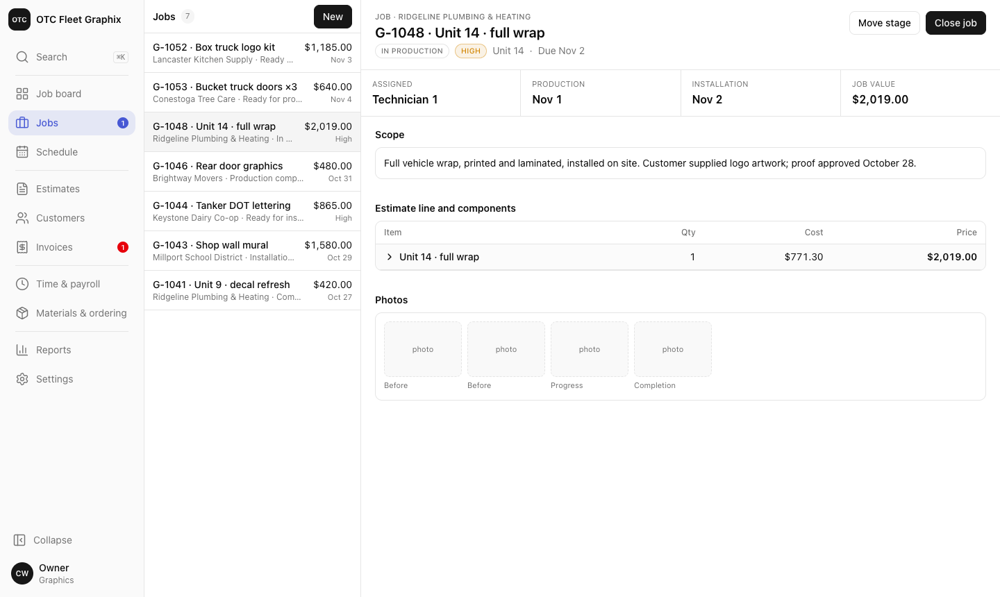

## What this is

**The shared names for the parts of a screen.** [[Domain Model]] fixes the words for the
*business* — job, estimate, customer line, component, stage. This fixes the words for the
*interface* — rail, list column, detail pane, chip.

**Why it exists:** eight parallel lanes will otherwise invent eight names for the same box. One
agent writes `Sidebar`, the next `NavRail`, the third `LeftNav`, and six months later nobody can
grep for the thing they mean. It is the same failure the single route table prevents, one level up.

> **The component name is the vocabulary.** This document is a map from the picture to the code,
> not a second source of truth. If a name here disagrees with `fleetco-ui/src`, **the code is
> right and this file is stale** — fix the file.



## The shell

```
┌────────────┬──────────────────┬─────────────────────────────────┐
│            │ ② section header │ ⑤ detail header                 │
│ ① rail     ├──────────────────┼─────────────────────────────────┤
│            │                  │                                 │
│  ⑦ search  │   ③ list rows    │   ⑥ detail pane                 │
│  ⑧ nav     │                  │     ├ stat strip                │
│  ⑨ badge   │                  │     └ detail section            │
│            │                  │                                 │
│ ⑩ collapse │                  │                                 │
│ ⑪ context  │  ← list column → │                                 │
│    cluster │                  │                                 │
└────────────┴──────────────────┴─────────────────────────────────┘
                   ④ bottom bar (phone only, replaces the rail)
```

| # | Name | Component | What it is |
|---|---|---|---|
| ① | **Rail** | `AppShell` | The left navigation. **Expanded** (208px, labels) or **collapsed** (56px, icons). Not "sidebar" — that alternative was built, compared, and dropped |
| ② | **Section header** | `SectionHeader` | The **band** at the top of the list column: section name, count and actions. `ListHeader` on list sections, `PageHeader` on wide ones. **There is no top banner** — it duplicated this |
| ③ | **List row** | `ListRow` | One record in the list column. A **row**, never a card. Carries an optional **monogram** and an **attention reason** |
| ③a | **Filter chips** | in `ListHeader` | All / Needs you. Only appear when something needs attention |
| ④ | **Bottom bar** | `AppShell` | The phone's navigation. Four items plus **More**, which opens the **More sheet** |
| ⑤ | **Detail header** | `DetailHeader` | A **band** carrying the eyebrow and the actions, then the title and subtitle below it |
| ⑥ | **Detail pane** | `ListDetailLayout` | The right pane. Holds a **stat strip** (the row of labelled numbers) and **detail sections** |
| ⑦ | **Search palette** | `SearchPalette` | Global search. Opened from the rail, `⌘K`, or the phone magnifier. Not a search *field*; there is nowhere to put one |
| ⑧ | **Nav item** | `AppShell` | One entry in the rail. Grouped into **nav groups** (work / sales / shop / admin) separated by a hairline |
| ⑨ | **Nav badge** | `NavBadge` | A **count** or a **dot** on a nav item. **Inline** count at the end of a labelled row; **overlay dot** on a collapsed icon — ten figures on ten icons is a rail you read instead of glance at |
| ⑩ | **Collapse toggle** | `AppShell` | Switches the rail between expanded and collapsed |
| ⑪ | **Context cluster** | `ContextCluster` | Avatar, department and account, at the foot of the rail |

## Smaller parts

| Name | Component | Notes |
|---|---|---|
| **Chip** | — | The rounded **solid** box behind an active icon, `--nav-active` with a white icon. The one "you are here" cue, used identically in the rail, the bottom bar and the More sheet |
| **Pill** | `Pill` | A small outlined status label — stage, invoice status, priority |
| **Stat strip** | `Stat` in a grid | The row of labelled numbers under a detail header |
| **Detail section** | `Section` | A titled block inside the detail pane, usually wrapping a table |
| **More sheet** | `AppShell` | The full-screen list the phone's More button opens |
| **Empty state** | `ListDetailLayout` | What the detail pane shows with nothing selected |

## The band

**Every header at the top of a column is one height**, set by `--spacing-band` and used as
`h-band`. **No exceptions** — the rail's logo row, the section header, the first row of a detail
header, and the back row all share it. The result is a single horizontal line running across the
rail, the list column and the detail pane.

The no-exceptions part is deliberate. A rule with one carve-out is a rule eight parallel lanes will
get wrong; the back row could have been shorter, since it only appears on a narrow screen where
there is nothing beside it to line up with, and it is `h-band` anyway because the simpler rule is
worth more than sixteen pixels of phone height.

Two consequences worth knowing before changing anything:

- **The detail header's actions sit in the band, not beside the title.** That is what makes them
  line up with the section header's button, and it keeps them in one place however long the title
  runs.
- **The rail's logo row has no bottom border.** The band sets the height, which is what does the
  aligning. A rule under the logo only chops the rail in two.

Before this rule the three headers centred at 28px, 24px and 33px. Retune the single token in the
visual pass; never hand-pick a height for one header.

## Surfaces

Three tones, `--surface-1/2/3`, named by depth rather than by component so the shell can be
re-layered without renaming tokens. 1 is furthest back (the rail and the phone's bottom bar), 3 is
the front (the detail pane).

**Panes are separated by tone, not by a rule.** The rail and the list column have no border on
their right edge; the step in tone does that work. Borders stay for **discrete objects** — cards,
inputs, tables, and the rows inside a list.

### Dark nav

A dark rail and bottom bar on an otherwise light app, **always** — there is no switch. The rail is chrome,
not content — a dark frame around the work keeps the brightest surface where the money is.

It is a **scoped token override**, not a pile of `dark:` classes: the rule redefines `--foreground`,
`--accent`, `--border`, `--brand` and friends on `.nav-surface` whenever the theme is light, and every utility inside already
reads those variables, so the nav items, separators, context cluster and its popover all re-skin
with **no component changes**. That is the token layer earning its keep.

> **The gotcha, and it cost a bug:** custom properties inherit, but a plain `<span>` with no colour
> class inherits the *computed* colour from `<body>`, resolved against the light `--foreground`
> before the scope existed. The scope must therefore also set `color: var(--foreground)` on itself.
> Any future scoped override needs the same line.

## Overlays

One primitive, `Overlay`, with two presentations. Both are a Radix Dialog underneath, so focus
trapping, escape, scroll lock and the aria wiring are identical and are not each lane's problem.

| Name | What it is for | Desktop | Phone |
|---|---|---|---|
| **Dialog** | A decision or a short form that **blocks** you. You answer, then carry on | Centred card | Full screen |
| **Panel** | Inspecting or editing a record while its **context stays on screen** behind it | From the right, full height | A sheet up from the bottom, capped so the context still shows |
| **Search palette** | Global search only. Not a general overlay | Centred, near the top | Full screen |

**The rule that stops agents guessing: a list section never uses a panel.** Those screens already
have a detail pane, and a panel over it is a second detail view of the same record. Panels exist
for `pane: "wide"` screens — the board, the schedule, timesheets — which have no detail pane. A
board card opens a panel; a customer row does not.

Dialogs go full screen on a phone rather than shrinking, because a centred card on a 390px screen
is a postage stamp with a keyboard over it.

The overlay's title is `text-base` — a heading, not a caption — and the close button is **40px**,
the same as a form control. This is the escape hatch, and on an iPad it is hit with a thumb; a
32px target in the corner of a dialog is the one nobody can reach in a hurry.

## Forms

| Name | Component | Notes |
|---|---|---|
| **Field** | `Field` | Label, control, and one line of hint **or** error. Never both |
| **Field row** | `FieldRow` | Two fields on a line where the container is wide enough |
| **Form body** | `FormBody` | The `@container` wrapper. Forms adapt to the width they are given, so the same form works in a panel and on a page |
| **Money input** | `MoneyInput` | Parses to integer cents (`PLAT-001`), `$` as an adornment, tabular and right-aligned |
| **Date input** | `DateInput` | Shop time, `America/New_York`, and the hint says so (`PLAT-003`) |

Three decisions, so no lane re-makes them:

1. **Labels sit above the field.** A label beside the field needs a second layout the moment
   the form is in a 390px phone or a 26rem panel, and this app puts forms in both.
2. **Optional is marked, not required.** Nearly every field in a shop system is required, so an
   asterisk on nine fields in ten is noise that stops being read.
3. **Controls are 40px tall** — taller than the shadcn default, because the primary device is an
   iPad on a shop floor and the primary hand may be gloved.

**A form lives in a panel or a page, never a dialog.** Dialogs are for a decision and at most two
or three fields; anything longer needs somewhere to scroll without fighting a keyboard.

## States

Four of them, and every UI card ships a screenshot of each — factory gate 8.

| Name | Component | The decision inside it |
|---|---|---|
| **Loading** | `LoadingRows` | **Skeletons, not a spinner.** A spinner says something is happening; a skeleton says what is about to appear and holds the layout, so nothing jumps when it lands |
| **Empty** | `EmptyState` | Says what is missing and offers the one action that fixes it |
| **Error** | `ErrorState` | What failed, plus a retry. **Never the raw error** — a stack trace tells Cam nothing and tells an attacker something |
| **Not found** | `NotFoundState` | Doubles as "not yours". See below |

**A technician who opens someone else's job gets "no such job", not "you do not have access".**
`ROLE-003` enforces assignment across lists, the board, the calendar, job records **and direct URL
access**. "You do not have access to this job" confirms the job exists and leaks its number; "no
such job" tells the only person who should care — the one who mistyped — exactly as much as they
need.

## Dense tables

| Name | Component | Notes |
|---|---|---|
| **Cell input** | `CellInput` | Editing inside a table. Transparent until hovered or focused, so the table reads as a table and edits as a form |
| **Money cell** | `MoneyCell` | Formatted while you read it (`$2,019.00`), raw while you type it (`2019.00`) |
| **Kind tag** | — | The small outlined label on a component: material, labor, allowance, custom item |

**Dense tables do not use the 40px form control.** A grid of forty bordered boxes is unreadable;
the border arrives on hover and focus instead. Money columns are always `tnum` and right-aligned —
an editable cell showing `2019.00` beside a computed one showing `$2,019.00` makes a column stop
lining up, which is the only thing a money column is for.

**Column priority, not horizontal scroll.** The estimate editor drops Margin below 1280 and Cost
below 1024, and the approval pill moves under the line name below `@md`. The line name and the
price never drop — they are what the screen is for.

## Board, drag and refusal

| Name | Component | Notes |
|---|---|---|
| **Board column** | `Column` in `Board.tsx` | One stage. Columns come from `STAGES` (`JOB-004`), never hardcoded |
| **Board card** | `Card` | A job. Tapping opens a **panel**; dragging moves the stage |
| **Drag overlay** | dnd-kit `DragOverlay` | The card follows the pointer; the original dims in place |
| **Toast** | sonner | After-action feedback. Bottom-right on a desktop, **top** on a phone — the bottom bar owns the bottom |

**Refusing an action is a design problem, and it has a shape.** `JOB-006` says a billable job with
no authorized line cannot enter Ready for production. Three things happen, in this order:

1. **Before the drop** — a column that will refuse this card goes dashed and dim as soon as the
   drag starts. The refusal is visible while there is still time to change course.
2. **On the drop** — the card snaps back. Nothing moves.
3. **After** — a toast names the job, the stage, and **why**. "Needs an approved line before it can
   go into production", not "invalid move".

Refusing silently is how a user decides the software is broken. Refusing without a reason is how
they decide it is stupid.

**No reordering inside a column.** Nothing in the Rules Catalog gives a card a position within a
stage, and adding one would be inventing a rule rather than implementing one.

**Technicians cannot drag at all** until `ROLE-008` (D-C2) is answered. Read-only is the reversible
default; granting the permission later breaks nothing, while taking it away would.

## Calendar

| Name | Component | Notes |
|---|---|---|
| **Week grid** | `CalendarPage` | Five day columns plus a time gutter, 7am–6pm. Desktop and tablet only |
| **Day list** | `DayList` | The phone's schedule. A time grid at 390px is a wall of empty boxes |
| **Entry** | `Entry` | Production or installation (`JOB-014`). Positioned absolutely by minutes from `DAY_START` |
| **Time gutter** | `TimeGutter` | The hour axis. Sticky on horizontal scroll |

**Built, not bought.** What makes calendar libraries expensive is recurrence, timezones and overlap
resolution. V1 has no recurring entries, one shop timezone (`PLAT-003`), and `JOB-016` says
overlaps are **allowed and unmanaged**. Strip those three and what is left is a positioned grid,
which is cheaper to own than to configure.

**What that gives up, to revisit rather than forget:** keyboard navigation, a month view, print, and
real timezone handling if OTC ever runs a shop in another one. Any of those arriving is a reason to
reopen the decision.

**`JOB-016` makes overlap a layout problem, not a validation problem.** Entries that overlap share
the column width. There is no warning, because the rule says V1 stays quiet.

**`JOB-015` is said out loud.** Dragging an entry toasts *"Dates only. The job board is
unchanged."* Two systems being deliberately separate is the kind of thing a user only half believes
until the software tells them.

## Photos

| Name | Component | Notes |
|---|---|---|
| **Photo grid** | `PhotoGrid` | Square tiles, add tile first. Used on the job record and in the job panel |
| **Photo tile** | `Tile` | Carries **its own** upload state — done, uploading, queued, failed |
| **Batch line** | in `PhotoGrid` | One line above the grid: counts, never a progress bar |
| **Status band** | in `Tile` | Fixed 20px strip. Always a bar, never words |

**Per-photo state, not a batch progress bar.** G13 asks the question this answers — *"what
happens when a 40-photo upload dies at photo 31 on shop wifi"*. A batch bar cannot say **which**
one failed, and `JOB-008` means a missing completion photo is what stops a technician finishing
the job. So each tile owns its state and retries alone, or all failures retry together.

**The band is always a bar, and it is one height.** A photo goes `queued` → `uploading` →
`confirming` → `done` without the status changing shape. A strip that swaps a bar for a word, or
changes height, makes a grid of tiles twitch as uploads land — which reads as instability in
exactly the moment the user already suspects the upload failed.

| State | Band | Why |
|---|---|---|
| `queued` | **Empty track** | Before the bytes move. Nothing is happening to this photo yet, and a moving bar would claim otherwise |
| `uploading` | Determinate fill | The one phase that knows how far along it is |
| `confirming` | Indeterminate sweep | Bytes have landed; the server has not said it kept them yet. No percentage exists |
| `done` / `failed` | No band | The tag and the retry overlay carry it |

The sweep runs **back and forth** (`alternate`), not left-to-right on a loop, and **starts on the
right** — the determinate fill before it ended at 100%, so the sweep carries that motion on instead
of snapping back to the start, which would read as the upload restarting. It collapses to a static
dimmed bar under `prefers-reduced-motion`.

**A failed tile can be discarded, not only retried.** Retrying nine failures on bad wifi is only
sensible if the three you no longer want can leave the queue.

### Open: who sets the tag

`JOB-008` requires "at least one photo tagged as a completion photo" but **nothing says how a photo
gets its tag.** The lab assigns it in the simulator, which is scaffolding, not a design. Three
candidates, in order of how well they survive a technician with forty photos:

1. **Context sets the default, and the finish flow confirms** *(recommended)*. Photos added from
   the job record default to Progress; "Mark work finished" asks which are completion photos. One
   decision over a batch, taken at the moment the tag actually matters.
2. **Bulk re-tag** — select tiles, apply a tag. Needed anyway as a correction path.
3. **Ask at capture** — a tag picker on every photo. Nobody will do this forty times.

Needs confirming with Cam, and it is adjacent to **D-C9** (`JOB-017`, checklist items undefined),
since condition photos belong to the checklists.

**A failed upload is not an error state for the screen.** `ErrorState` would blank the gallery and
hide the photos that did land. The tile carries the failure; everything else stays usable.

**`JOB-008` checks for an *arrived* completion photo.** One sitting in a failed queue is not
evidence of anything, so `hasUploadedCompletionPhoto` requires `state === "done"`. The refusal
follows the board's three beats: the reason sits next to the button before you press it, the press
is refused, and the toast repeats why.

**The tag is always legible, never on hover.** It is the thing `JOB-008` reads, and the primary
device is a phone with no hover at all.

**Two axes on one tile, and they are not the same thing.** The **tag** says what a photo *is* —
before, progress, completion, condition — and never changes. The **bottom banner** says where it is
in the upload, and disappears once it lands. A tile reading "Completion / Waiting to upload" is the
exact case `JOB-008` turns on.

> The completion tag only goes brand-filled once the photo has **arrived**. Amber means "this one
> counts" everywhere else in the app, and a completion photo still in the queue does not count —
> colouring it early promises what the gate refuses.

> **`--nav-active` is a separate token from `--brand`, on purpose.** Brand is tuned to be *read* —
> badge fills, small coloured text — and in the warm palette that is a bright amber. A white icon
> on bright amber is about 2:1 and illegible. The chip is tuned to be *sat on*, so it is a deeper
> bronze that carries white at roughly 5:1. One token cannot do both jobs.

## Attention

**A badge says "N things need you here". The list it points at must be able to show you
which N.** Otherwise the badge tells someone something is wrong and gives them nowhere to go.

So the rail badge and the list's "Needs you" filter are derived from **one function** —
`nav/attention.ts` — and cannot disagree. Changing what counts as needing attention changes
both at once, which is the only way this stays true after eight lanes have touched it.

| Section | What needs attention | Rule |
|---|---|---|
| Customers | Owes money that is past due | `INV-010` status is derived |
| Jobs (owner) | Work finished, waiting to be closed | `JOB-007` |
| Jobs (technician) | Assigned and not started | — |
| Invoices | Overdue, or a draft never sent | `JOB-009` creates it unsent |

The row shows the **reason**, not just a mark: "Payment overdue" rather than a bare dot. A
mark says *something*; the reason says *what*, and it is the same number of pixels.

### One colour, three places

`--attention` is a **solid chip in one colour across both themes**, with `--attention-fg` dark
text on it. It appears in exactly three places, and they are meant to be recognised as the same
thing: the **rail badge**, the **row's reason chip**, and the **count inside the "Needs you"
filter**.

> **Coloured text could never tie them together.** The badge sits on a dark rail and the row on
> a light list, so the two can never share a text colour — and matching the dark theme's bright
> amber as light-theme text measured **1.47:1**. A *fill* can be shared: dark-on-amber is legible
> on any surface, so the chip is literally the badge colour in both themes.

The filter chip itself stays a plain control. Only its count wears the colour — tinting the whole
control as well makes a filter look like a warning.

A **status pill** joins that set only when the status and the reason are the **same fact**.
`OVERDUE` is both the invoice's status and the whole reason it needs chasing, so one mark does
the work of two and it takes the badge's colour.

`DRAFT` is the case that draws the line. It is in the attention count, but the reason is "never
sent" — the status is where the invoice sits in its life, and the reason says more than the
status does. So they stay two marks: the row chip carries the reason, and the pill stays a plain
status. Colouring `DRAFT` would say the state itself is the alarm, and every new invoice is a
draft for a moment.

The test is a comparison against `attentionMap`, never a hardcoded `=== "Overdue"`, so the colour
cannot drift from what the badge counts. If a reason's wording changes the pill falls back to a
plain status — the safe direction, because the failure is a missing colour rather than an
invented one.

Everything else keeps its own tone. `PAID` is green, `SENT` and `IN PRODUCTION` are grey: those
are *states*, and a state nobody has to act on must not borrow the colour of one that does.

### Every pill is a solid fill, no border

An outline and a tint are two ways of drawing the same edge. Keeping both made the pills fussy at
10.5px, and the border was doing the work the fill should do. So every tone is now a solid fill
with no border, and the tones differ only in colour.

They are **opaque**, not an alpha tint. The old pills were `/10` over whatever sat behind them, so
the same `DRAFT` changed colour between a plain row, a hovered row and a selected one — a status
does not mean something different because the row is selected.

They are defined **once per theme, not per palette**. A pill is a small chip of meaning rather
than part of the page's character, and `PAID` should not be a different green because someone
picked the warm palette.

| Tone | Used for |
|---|---|
| `attention` | the one saturated fill — the badge's colour, when the status is the reason |
| `warn` | `HIGH`, `Overridden`, `Partially approved` |
| `good` | `PAID`, `Approved` |
| `bad` | `Declined`, voided |
| `default` / `muted` | everything else — the same fill at two text volumes |

Warn sits at hue 50 rather than `--warning`'s 70, to pull it away from the attention amber at 85.
"Rush" and "needs you" are different claims and must not look like the same one.

**A control is not a pill.** The estimate's `Pending` keeps its dashed outline because it is a
button — nothing has been recorded yet, and the dashes say so. Filling it would make an empty slot
look like an answer.

**Sections without a list never get a badge they cannot explain.** There is no mode that adds
decorative counts — badges are either on and derived, or off.

**A collapsed rail shows a dot, not a number.** The figure is a click away in the list, and a
column of ten icons each carrying a count stops being glanceable, which is the only reason a
collapsed rail exists.

## Row actions

**The action lives where the state is.** A pending line's approval cell is a **button**
that opens the one dialog covering all three outcomes, rather than a label with the
controls elsewhere on the page.

**Only an actionable row is actionable.** An override on an already-approved line is
meaningless, so a settled line shows a plain pill and no menu. Offering an action that
makes no sense invites the mistake it describes.

A history block records what happened and is **read-only**; acting happens next to the
record, not under it.

## Authorization

**An override is not an approval, but both are authorizations.** `AUTH-005`: a line is
authorized if its latest state is Approved **or** Overridden — same downstream effect.
`AUTH-004`: an override is recorded and displayed as an override, **never** as customer
approval. An approval says what the *customer* said; an override says what *OTC decided*
when they did not.

**One dialog, three outcomes.** The user's job is "resolve this pending line", so splitting
it into two dialogs made one task look like two, and left the override harder to find than
it should be.

**Three peer buttons — Approved, Declined, Override — none pre-selected, and the form
follows the choice.** Until one is picked there is nothing to fill in. Picking Override
swaps it again: the consequence panel appears, contact and method go away, a reason
becomes required, and the confirm button turns to the warning treatment.

> **No default outcome, for the same reason the method field has none.** The lines arrive
> all ticked — `AUTH-001` blesses "approve all" — so a pre-selected *Approved* on top of
> that would make **"approve everything the customer was offered"** the one-click path.
> On a three-line estimate where they agreed to two and refused one, that is the exact
> error the record exists to prevent. Picking the outcome is the first deliberate act,
> not a correction of a guess.

> The restraint on an override is the **required reason and the stated consequence**, not a
> harder path to reach it. Hiding it only teaches people to hunt for it, and the third
> button is where someone looks when the customer has not answered.

**Still unknown, and it could invert this:** how often Cam actually overrides. Recording
"Dana said yes on the phone" is an *approval* with method `phone` (`AUTH-011`), not an
override — overrides are for when nobody answered at all. If that turns out to be his
daily path rather than an exception, the override should be promoted to a peer.

## Light accents work harder than dark ones

The warm palette's amber sits far from a dark surface and pops. The same hue on cream
measured **4.06:1** — under the AA floor for small text, and visibly soft, which is why the
attention cues read fine in dark and faded in light.

`--brand` is therefore **deeper in light than the dark value is light**: `oklch(0.52 0.13 85)`
against `oklch(0.82 0.15 85)`. It is not the same colour at two brightnesses, and treating it
as one is how a light theme ends up washed out.

**The hue stays fixed at 85 across every variant.** The rail is a dark surface with its own
brand, so a badge and the rows it points at can never share a hex — what reads as a highlight
on a dark rail is unreadable on cream. They must still read as *the same colour*, and only a
shared hue does that. A first pass at the light value drifted to hue 68 for contrast, and the
badge and its rows immediately looked unrelated.

Colour alone was not enough at 12px either: the attention line also carries `font-medium`, and
an inactive attention chip gets a `bg-brand/10` fill so it reads as a chip rather than as
coloured text. **Measure, do not eyeball** — both of these looked "fine" until the ratio came
back.

## Naming rules

1. **Pane, column, bar, sheet — pick by behaviour, not by looks.**
   *Pane* fills the remaining space. *Column* has a fixed width. *Bar* is a thin full-width strip.
   *Sheet* covers the screen and is dismissed.
2. **The thing is named for what it holds, not where it sits.** "List column", not "left column" —
   it is the only pane on a phone and sits nowhere in particular.
3. **No synonyms.** Sidebar, nav bar, menu, drawer and panel are all **banned** in favour of the
   names above. A review comment saying "this is the rail, not the sidebar" is doing its job.
4. **Two words for two things.** A **count badge** says how many are waiting; a **dot badge** says
   something is off. Never call either a "notification".
5. **Layout names are role-independent.** There is no "technician rail" — there is a rail, filtered
   by role.
6. **A new name needs a component.** If there is nothing in `fleetco-ui/src` to point at, the thing
   does not need a name yet.

## Known gaps

Parts the design system does not have yet, so they have no agreed name. Each gets one when it is
built, and that is the moment to add it here rather than later:

- Confirm-destructive dialogs, which probably want their own variant (`INV-012` voiding,
  `JOB-011` cancelling)
- Anything on a customer-facing surface (estimate PDF, invoice PDF, payment page) — that is a
  **second design surface** with its own vocabulary, and `ROLE-009` means it cannot borrow internal
  components wholesale

## Related

- [[Domain Model]] — the business vocabulary this sits alongside
- [[Software Factory]] — why one vocabulary matters across parallel lanes
- [[Work Cards]] — cards name screens; those names come from here
- [[Code Standards and Guardrails]] — naming sits in Tier 4, conventions
- `fleetco-ui/README.md` — how to run the device lab and see all of this
